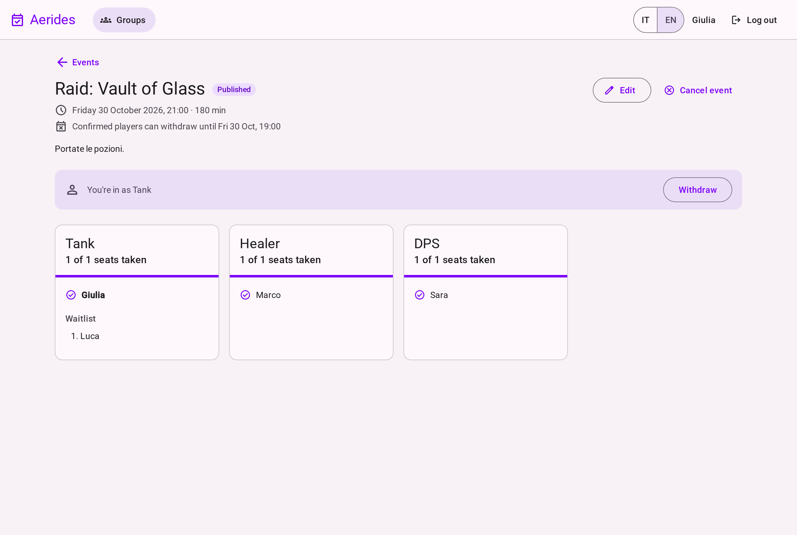
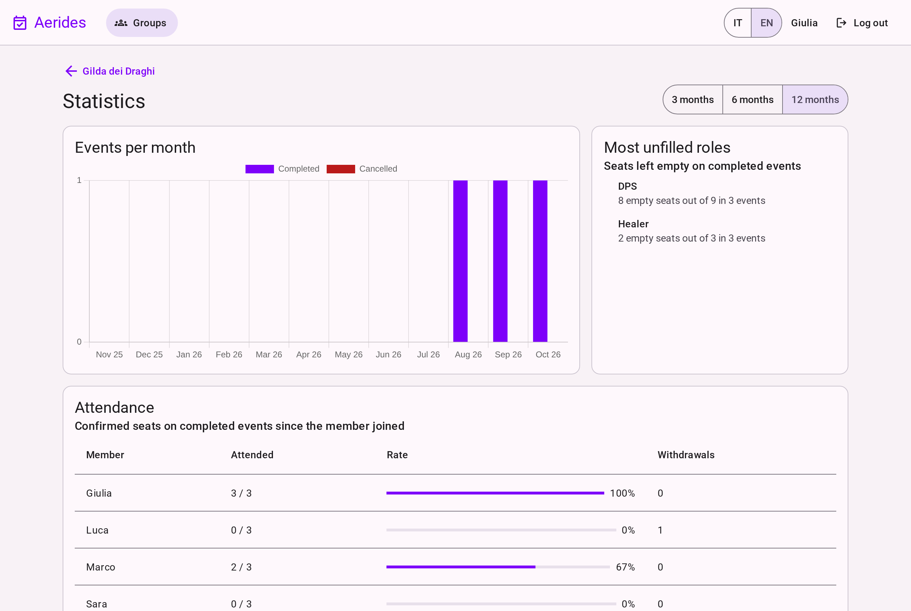
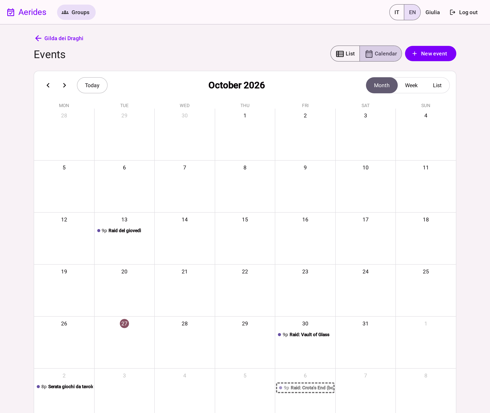
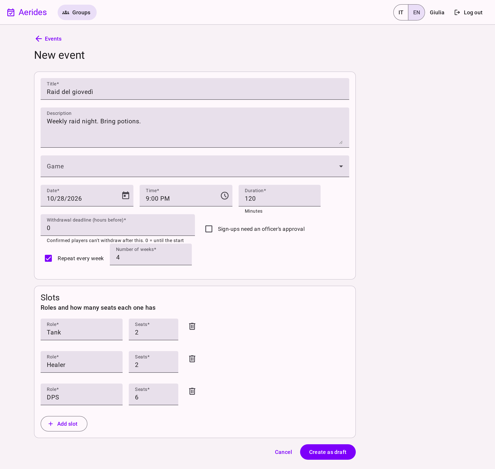
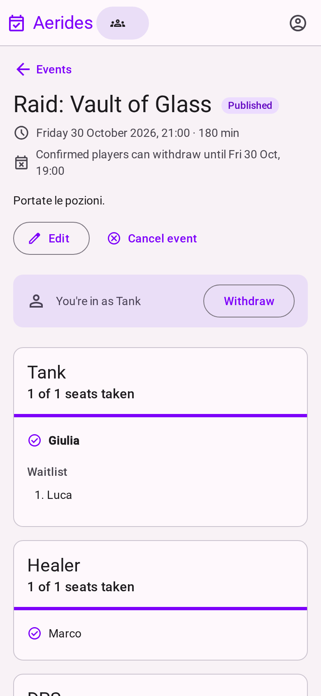
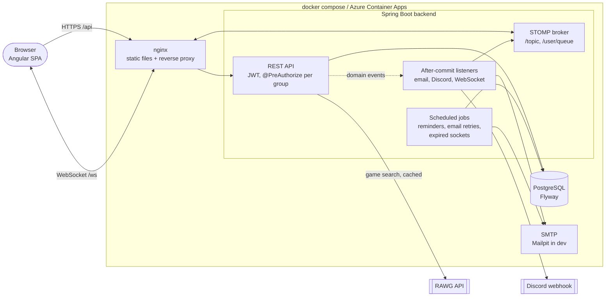

# Aerides

**A multi-tenant scheduling app for gaming groups: events with role-based slots, sign-ups, automatic waitlists, live updates, reminders and attendance stats.** Java 21 + Spring Boot 4 backend, Angular 22 frontend, PostgreSQL, shipped with Docker, GitHub Actions and Terraform.

Under the theme it is a **resource-booking business application**, the kind consulting firms build for banks, insurers and public administration: per-tenant roles and permissions, approvals, concurrency-safe bookings, notifications, an audit log and reporting.

[](https://github.com/Federico-Ordonselli/aerides/actions/workflows/backend.yml)
[](https://github.com/Federico-Ordonselli/aerides/actions/workflows/frontend.yml)
[](https://github.com/Federico-Ordonselli/aerides/actions/workflows/e2e.yml)
[](https://github.com/Federico-Ordonselli/aerides/actions/workflows/docker.yml)
[](https://github.com/Federico-Ordonselli/aerides/actions/workflows/infra.yml)
[](https://github.com/Federico-Ordonselli/aerides/actions/workflows/secrets.yml)

## Try it

> ### [▶ Open the live demo](https://federico-ordonselli.github.io/aerides/)
> The free instance sleeps after 15 idle minutes: this page wakes it up (about 2 minutes) and opens the app when it's ready.
>
> | Account | Role in "Gilda dei Draghi" | Password |
> |---|---|---|
> | `giulia@example.com` | Owner | `aerides-demo` |
> | `marco@example.com` | Officer | `aerides-demo` |
> | `luca@example.com` | Member, waitlisted on "Vault of Glass" | `aerides-demo` |
>
> **Two-minute tour**: log in as Luca and open "Raid: Vault of Glass"; as Giulia in a private window, withdraw from the Tank slot. Luca is promoted and sees it live. Then look at *Statistics* and, as Giulia, the *Audit log*.
>
> All six accounts: [docs/demo-accounts.md](docs/demo-accounts.md) · API: [Swagger UI](https://aerides.onrender.com/swagger-ui.html) (authorize with the `accessToken` returned by a login)

## Screenshots

| | |
|---|---|
|  **Event detail**: role slots, waitlist, live updates |  **Statistics**: events per month, unfilled roles, attendance |
|  **Calendar**, loaded on demand |  **Event form**: slots, weekly series, validation |

<p align="center"><br><em>Responsive down to phone size</em></p>

## Features

- **Groups and roles**: create a group, invite people with a code, three roles per group (owner, officer, member) enforced on every endpoint. Outsiders get 404, not 403.
- **Game catalog**: search the public RAWG API (debounced, cached, graceful when it's down) and add games to the group.
- **Events**: role-based slots (2 tanks, 2 healers, 6 DPS…), drafts, publishing, cancelling, completing, weekly series, a filtered and paginated list, a calendar view.
- **Sign-ups**: pick a role; a full role puts you on a FIFO waitlist; a withdrawal promotes the next person in the same transaction; optional officer approval; withdrawal deadline.
- **Real time**: the sign-up list updates live over WebSocket (STOMP); a promoted user gets a toast.
- **Notifications**: reminder email 24 h before the event (exactly once), promotion email, retries for failed emails, optional Discord webhook per group. Emails in Italian or English.
- **Dashboard**: attendance per member, events per month, most unfilled roles, in the user's time zone.
- **Audit log**: who created, changed or cancelled what, and when, for officers and owners.
- **Polish**: Italian and English UI, responsive layout, empty and error states.

## Architecture



- **One origin**: nginx serves the Angular build and proxies `/api` and `/ws`, so the refresh cookie can be `SameSite=Strict` and the backend is never exposed directly.
- **Package by feature** (`auth`, `group`, `event`, `signup`, …): each package holds its controller, service, repository and DTOs; entities never leave the service layer.
- **Side effects after the commit**: services publish domain events; emails, WebSocket messages and Discord posts are sent only once the transaction has committed.
- **PostgreSQL does the hard guarantees**: row locks against overbooking, partial unique indexes, `ON CONFLICT` for exactly-once emails.

How each of these works, with its trade-offs and the test that proves it: **[docs/DESIGN.md](docs/DESIGN.md)**. Scope, data model and the 10 business rules: [docs/SPEC.md](docs/SPEC.md).

## Tech stack

| Layer | Technologies |
|---|---|
| Backend | Java 21, Spring Boot 4.1, Spring Security (JWT resource server), Spring Data JPA / Hibernate 7, PostgreSQL 17, Flyway, MapStruct, Bucket4j, Thymeleaf (emails), springdoc-openapi |
| Frontend | Angular 22 (standalone components, signals, zoneless), Angular Material 3, RxJS, STOMP (rx-stomp), FullCalendar, Chart.js via ng2-charts, ngx-translate (IT/EN) |
| Testing | JUnit 5, Mockito, Testcontainers, MockMvc, WireMock, GreenMail, Awaitility, Jest, Playwright |
| DevOps | Docker, Docker Compose, nginx, GitHub Actions, GitHub Container Registry, Terraform (Azure Container Apps), Render + Neon (demo), gitleaks, Dependabot |

## Run it locally

Requirements: Docker with Compose. One command creates `.env` with a random JWT secret and starts PostgreSQL, the backend, nginx with the app, and Mailpit:

```bash
sed "s|^JWT_SECRET=.*|JWT_SECRET=$(openssl rand -base64 48)|" .env.example > .env && docker compose up --build
```

| URL | What |
|---|---|
| http://localhost:4200 | the app (register a user, or use development mode below for the demo data) |
| http://localhost:8080/swagger-ui.html | API documentation |
| http://localhost:8025 | Mailpit: every email the app sends |

**Development mode** (hot reload, demo data): `docker compose up -d postgres mailpit`, then `SPRING_PROFILES_ACTIVE=dev ./mvnw spring-boot:run` in `backend/` (seeds the demo accounts above on an empty database) and `npm install && npm start` in `frontend/`. Game search needs a free [RAWG API key](https://rawg.io/apidocs) in `RAWG_API_KEY`; without it the search box says the catalog is unavailable and everything else works.

## Testing

| Suite | Count | What it covers |
|---|---:|---|
| Backend unit (`*Test`) | 150 | services with mocked repositories: business rules, permissions, edge cases, configuration |
| Backend integration (`*IT`) | 206 | the real API through the security filters on PostgreSQL (Testcontainers): the full access matrix, concurrency, locks, emails (GreenMail), Discord (WireMock), WebSocket clients |
| Frontend (Jest) | 91 | components, services, interceptors, validators, cross-tab refresh, i18n keys in both languages |
| End-to-end (Playwright) | 2 | two users in two browsers: register → group → event → waitlist → live promotion + email; two tabs refreshing the session at once |

```bash
cd backend && ./mvnw verify                          # unit + integration (needs Docker)
cd frontend && npm run lint && npm test && npm run build
cd e2e && npx playwright test                        # against `docker compose up`
```

- **Rules are tested where they are enforced**: overbooking with 20 parallel sign-ups on a 3-seat slot against real PostgreSQL, exactly-once reminders by running the job twice in parallel.
- **Every guard was mutation-checked**: the row lock, the unique index, the `ON CONFLICT`, the access checks, the cross-tab lock were each removed by hand to watch their test fail.
- **No sleeps**: concurrency tests start their threads together with latches; the two-tab e2e test reads the browser's lock state with `navigator.locks.query()`.
- **CI**: six workflows, each triggered only by the folders it covers: backend, frontend (with a bundle budget), e2e on the full compose stack, Docker images to GHCR, Terraform `validate`, gitleaks secret scanning.

## Security notes

- **Tokens**: 15-minute JWT access token kept in memory only; refresh token in an `HttpOnly`, `Secure`, `SameSite=Strict` cookie scoped to `/api/auth`, stored as a SHA-256 hash, **rotated on every use with reuse detection** (a replayed token revokes all of the user's sessions). Refreshes are serialized across browser tabs with the Web Locks API, so two tabs never trip reuse detection.
- **Multi-tenancy**: every group endpoint is guarded by `@PreAuthorize`, and every lookup also filters by group id, so an id from another group is never found even if a check were forgotten. `GroupAccessIT` and `EventAccessIT` test every endpoint × outsider, member, officer, owner.
- **Brute force**: Bucket4j rate limits on login (per IP + email, per IP, per account) and on refresh; login takes the same time for unknown emails, so timing doesn't reveal which accounts exist.
- **WebSocket**: authenticated on `CONNECT`, authorized on every `SUBSCRIBE`; sockets are closed when a member loses access or the token expires.
- **Least privilege in the database**: Flyway migrates as the schema owner; the app's connection pool uses a role that can only read and write rows.
- **Secrets**: none in the repository (gitleaks on every push); the backend refuses to start without a strong `JWT_SECRET` and never prints it. API docs are off by default, on only in development and in the public demo.
- **Known trade-offs**, written down rather than hidden: registration reveals whether an email exists; rate-limit buckets are per instance. Details in [docs/DESIGN.md](docs/DESIGN.md#security-design).

## Deployment

- **Live demo**: [Render](https://render.com) free tier ([`render.yaml`](render.yaml)) + [Neon](https://neon.com) PostgreSQL. One container serves the Angular app from Spring Boot, so app, API and WebSocket stay on one origin. Startup on Render's 0.1 CPU went from 257 s to 102 s (extracted jar, AppCDS, C1-only JIT); Render redeploys only when the image's inputs change. Emails are logged instead of sent. Setup: [deploy/render/README.md](deploy/render/README.md).
- **Production-like**: [`infra/`](infra/) is Terraform for Azure Container Apps (nginx public, backend on an internal ingress) and PostgreSQL Flexible Server with `sslmode=verify-full`. It is written and validated in CI, never applied; its open gaps are under [Next steps](#next-steps).
- **Images**: every push to `main` publishes the backend and frontend images to GitHub Container Registry, tagged `latest` and `sha-<commit>`.

## Engineering notes

What building this taught me:

- **Let the database guarantee what it can.** A `SELECT … FOR UPDATE` on the slot row makes overbooking impossible; the same concurrency test without it confirms 10 people for 3 seats. Checks in application code alone are a race.
- **Don't send side effects from inside a transaction.** An email sent before a rollback can't be unsent. Domain events handled after the commit keep services unaware of email, WebSocket and Discord.
- **A test you haven't seen fail proves little.** With the cross-tab lock removed, four of its five unit tests still passed; they now also check that the second tab waits.
- **Measure before optimizing.** The slow cold start wasn't the database: it was Hibernate validating every repository query on a cold JVM. Lazy initialization made the "Started" log line faster but not the first response, so it was dropped; class-data sharing and a cheaper JIT were kept.
- **Error messages can leak secrets.** A validation failure on the JWT secret printed its value in the startup log; the check moved into code, with a failure analyzer that never echoes it.
- **Managed services have sharp edges.** Neon's connection pooler runs in transaction mode, which silently drops session settings such as `lock_timeout` and Flyway's lock, so the demo connects to the direct endpoint.
- **Write the trade-offs down.** The in-memory broker, per-instance rate limits and the email-enumeration choice are documented with what would replace them.

## Project structure

```
backend/    Spring Boot API, package by feature: auth, user, group, game, event, signup,
            audit, stats, realtime, notification, demo, common
frontend/   Angular app: core (auth, HTTP, i18n, layout, realtime), shared, features (lazy-loaded)
e2e/        Playwright tests against the whole stack
infra/      Terraform for Azure (validated, never applied)
deploy/     Render demo image (Angular served by Spring Boot)
wake-page/  static page on GitHub Pages that wakes the demo up
docs/       SPEC (scope, business rules), DESIGN (how and why), demo accounts, screenshots
```

## Next steps

All six milestones of the [original plan](docs/SPEC.md#milestones) are done. Deliberately left out:

- **Azure hardening**: a virtual network to close PostgreSQL's public endpoint, and Flyway in a separate Container Apps job so the running app never holds the schema owner's password ([infra/README.md](infra/README.md)).
- **Horizontal scaling**: rate-limit buckets in Redis and a STOMP broker relay (RabbitMQ); both are in memory today, so the backend runs as one instance.
- **"Recognized device" cookie**: let known devices skip the per-account login limit, so an attacker can't lock the real user out for 15 minutes.
- **Product**: edit a whole weekly series at once, per-user time zones in emails, no-show tracking for real attendance, ownership transfer.
- **Frontend**: load FullCalendar's CSS (~30 kB) with its deferred chunk instead of globally.

---

*About the name: the Tower of the Winds in Athens, the* Aerides, *showed the winds and the time of day: the place to know when to gather.*
