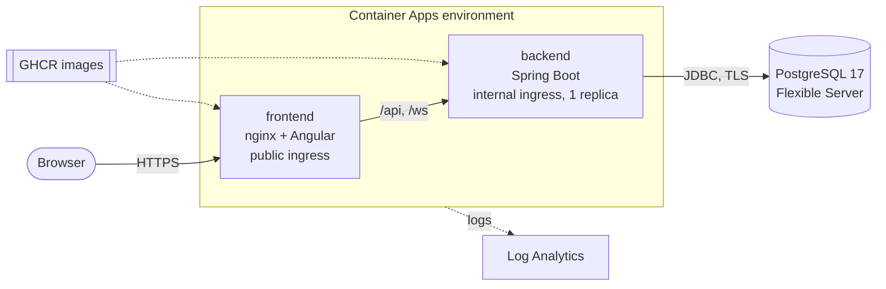

# Raidboard on Azure (Terraform)

Infrastructure as code for a production-like deployment on Azure. **Written and validated, never applied**: CI runs `terraform fmt -check` and `terraform validate` on every change (`.github/workflows/infra.yml`), but nothing is deployed from here. The public demo runs on Render instead (see the main README).

## What it creates



| File | Resources |
|------|-----------|
| `main.tf` | resource group, Log Analytics workspace, Container Apps environment |
| `database.tf` | PostgreSQL Flexible Server (B1ms, 32 GB, 7-day backups), the `raidboard` database, firewall rule for Azure services |
| `apps.tf` | `backend` and `frontend` container apps, their secrets, environment variables and health probes |
| `variables.tf` / `outputs.tf` | inputs (secrets are `sensitive`) and the public URL |

## Design choices

- **Same shape as docker compose**: nginx is the only public entry point and forwards `/api` and `/ws` to the backend, so the browser sees one origin (no CORS, `SameSite=Strict` refresh cookie). The backend has an *internal* ingress: nothing outside the environment can call it, which also keeps `X-Forwarded-For` trustworthy for the rate limiter.
- **The nginx upstream is configurable** (`frontend/nginx.conf.template`, filled in at container start): `http://backend:8080` in compose, the backend app's name here. The Container Apps ingress routes by `Host` header, so nginx sends the backend's host name instead of the browser's.
- **Exactly one backend replica**: the STOMP broker, the rate-limit buckets and the WebSocket token registry live in memory. Scaling out needs a broker relay (RabbitMQ) and a shared store (Redis) first; the frontend has no state and scales to two.
- **Secrets** (`jwt_secret`, database password, API keys) are `sensitive` variables, stored as Container Apps secrets and passed as environment variables, the same names the app reads everywhere else (`.env.example`). Optional secrets are created only when set, because Container Apps refuses empty ones.
- **Images by commit SHA**: the Docker workflow pushes `ghcr.io/<repo>-backend:sha-<commit>`; deploying an exact tag makes a deployment reproducible and a rollback a one-line change.
- **Client IP behind the ingress**: in compose nginx is the edge and overwrites `X-Forwarded-For`. Here the Container Apps ingress is the edge, so nginx *appends* to its header (`FORWARDED_FOR=$proxy_add_x_forwarded_for`), and Tomcat picks the right-most address that isn't a private network: the real client, not the ingress. Without this, every user would share one rate-limit bucket, and 20 failed logins by anyone would block login for everyone.
- **TLS to the database is verified** (`sslmode=verify-full` with `sslfactory=DefaultJavaSSLFactory`): the certificate and the host name are checked against the JRE's CA store, not only encrypted. Without the factory, pgjdbc would look for `~/.postgresql/root.crt` like `libpq` does, and fail.
- **Least-privilege database role**: the backend's connection pool logs in as `raidboard_app`, which can SELECT, INSERT, UPDATE and DELETE rows and nothing else: no DDL, no access to Flyway's history table. Flyway logs in as the administrator, who owns the schema (`SPRING_FLYWAY_USER`), and after each migration `AppRoleProvisioner` creates the role, sets its password (SCRAM-hashed by the driver) and grants the rows of every table again. No VNet needed, and Terraform never connects to the database.
- **Known gaps, required before real production use** (noted in `database.tf`):
  - **Private networking**: PostgreSQL has a public endpoint. The "Azure services" firewall rule admits any Azure customer's resources, so the password and TLS are what protect it. The fix: a delegated subnet for the server, a private DNS zone, the Container Apps environment in the same virtual network, public access disabled.
  - **Migration credentials in the app**: the backend container still holds the administrator's password, because Flyway runs at startup. A separate Container Apps job for the migrations would keep it out of the application, so a compromised backend could only touch rows.

## Running it

```bash
cd infra
cp terraform.tfvars.example terraform.tfvars   # fill in subscription, secrets, image tag
az login
terraform init
terraform plan -out=tfplan
terraform apply tfplan
terraform output app_url
```

## After deploying

Check that the rate limiter sees real client addresses, not the ingress's. That depends on the ingress's addresses matching Tomcat's `server.tomcat.remoteip.internal-proxies` (by default: private networks, including `100.64.0.0/10`), and only a real deployment can tell.

```bash
# 1. Turn on the client address log (this creates a new revision). It's the package, not the class:
#    Spring Boot lowercases environment variable names, so they can't name a class logger.
az containerapp update -g raidboard-prod-rg -n raidboard-prod-backend \
  --set-env-vars LOGGING_LEVEL_DEV_ORDONSELLI_RAIDBOARD_COMMON_WEB=DEBUG
# 2. Call the API from your machine, and note your public IP
curl -s -o /dev/null "$(terraform output -raw app_url)/api/auth/refresh" -X POST
curl -s https://ifconfig.me
# 3. Read the log line: "POST /api/auth/refresh from <address> (unconsumed X-Forwarded-For: ...)"
az containerapp logs show -g raidboard-prod-rg -n raidboard-prod-backend --tail 50 | grep "from "
# 4. Turn it off again
az containerapp update -g raidboard-prod-rg -n raidboard-prod-backend \
  --remove-env-vars LOGGING_LEVEL_DEV_ORDONSELLI_RAIDBOARD_COMMON_WEB
```

- `<address>` is your public IP: done.
- It's a private or `100.x` address: an ingress hop isn't matched as internal. Set `SERVER_TOMCAT_REMOTEIP_INTERNAL_PROXIES` to a regex that matches it, then check again. Until then every user shares one rate-limit bucket.
- It's an address you sent yourself (`curl -H "X-Forwarded-For: 1.2.3.4"` shows `1.2.3.4`): a hop trusts too much. Stop and fix it before going live, because anyone could then pick their own rate-limit bucket.

Remove everything with `terraform destroy` (or by deleting the resource group). For a team, uncomment the `azurerm` backend in `versions.tf` so the state is shared and locked.

**Rough cost** (list prices, always on, may differ by region): PostgreSQL B1ms about €15/month, Container Apps 0.75 vCPU / 1.5 GiB about €25/month, Log Analytics a few euros at this volume.
